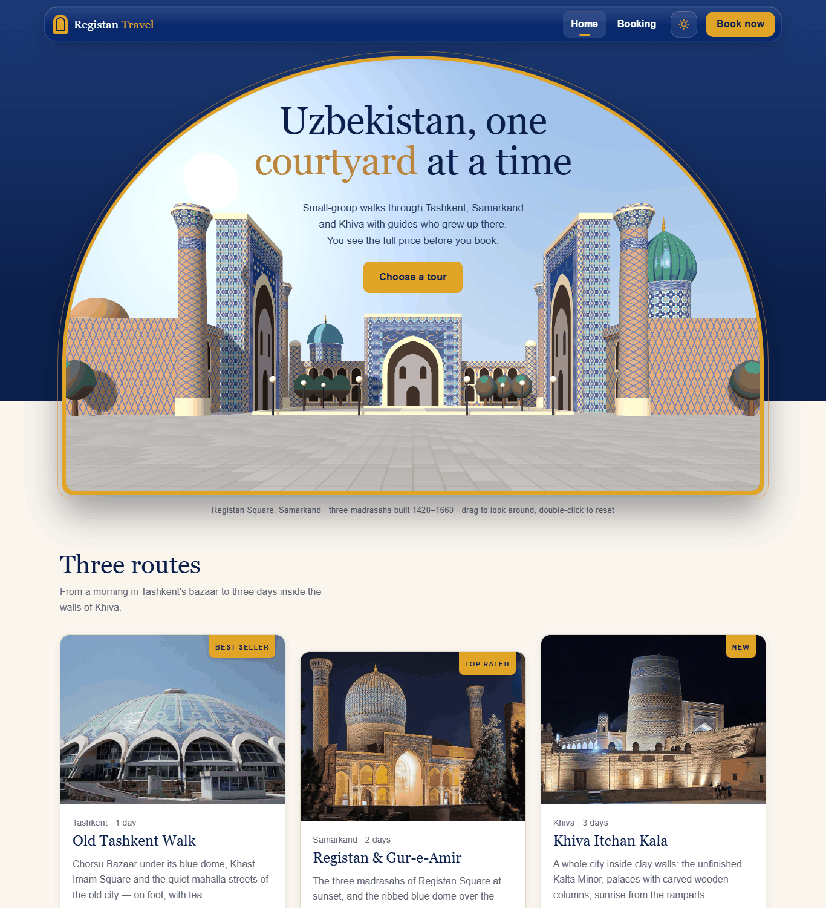
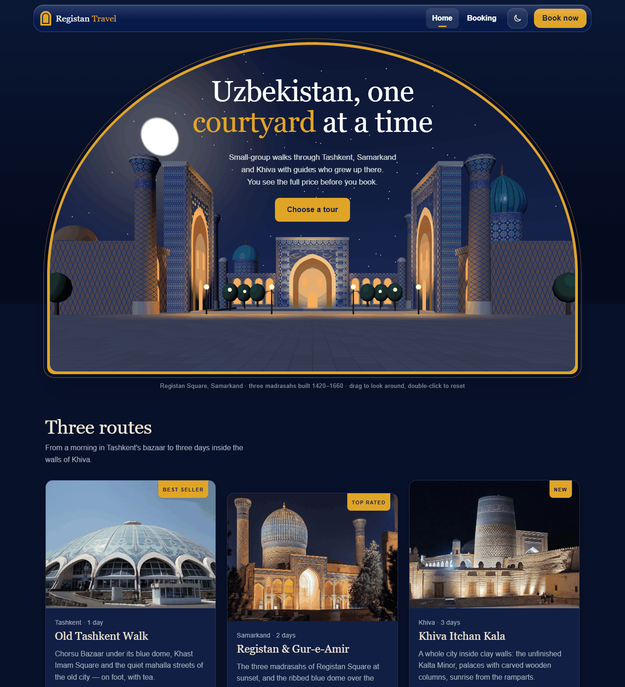
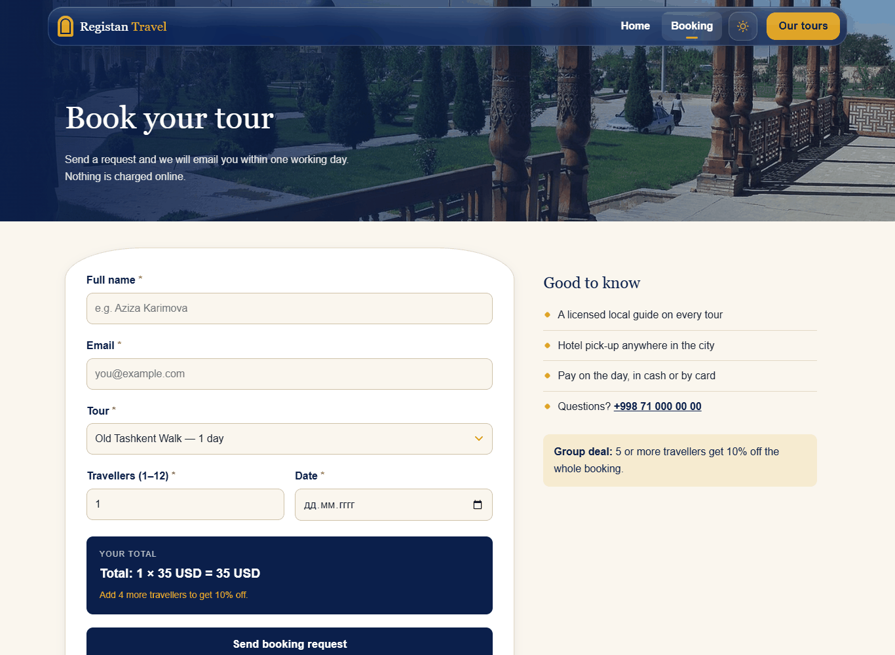
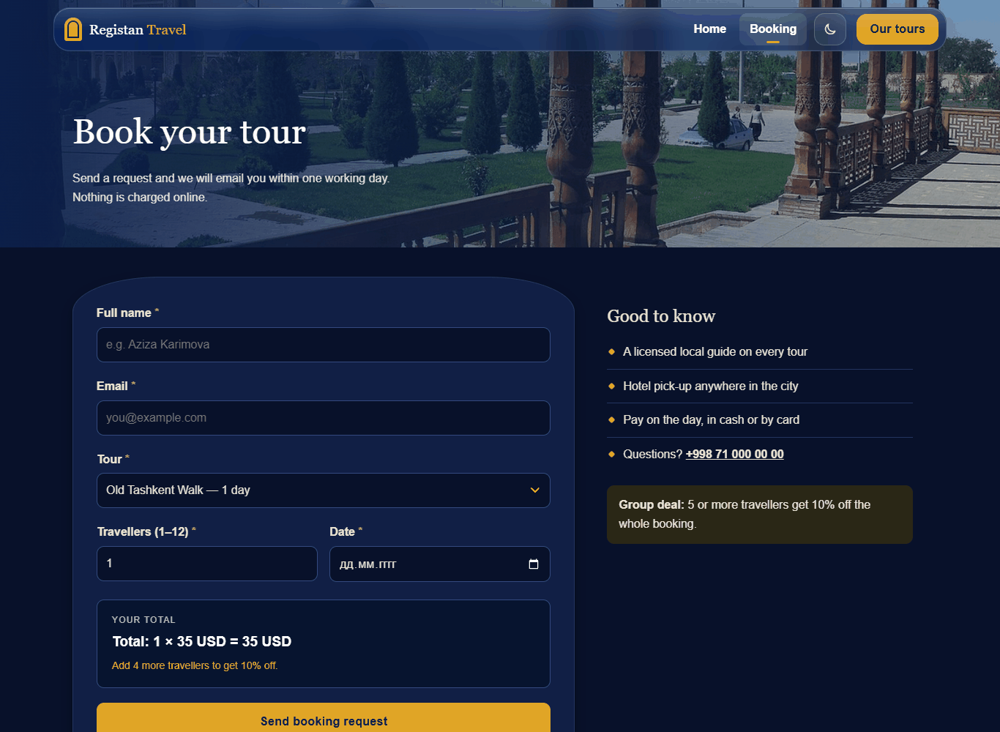
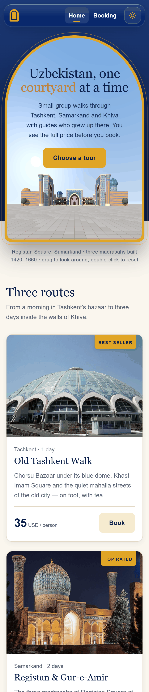
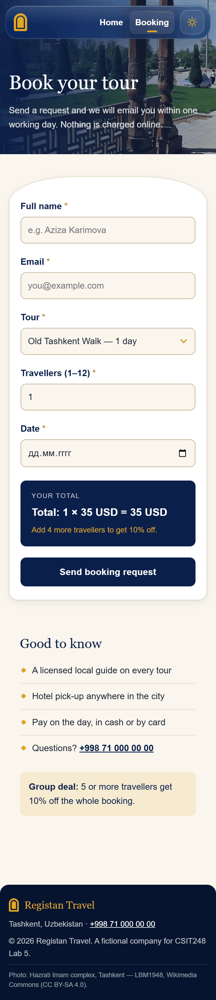
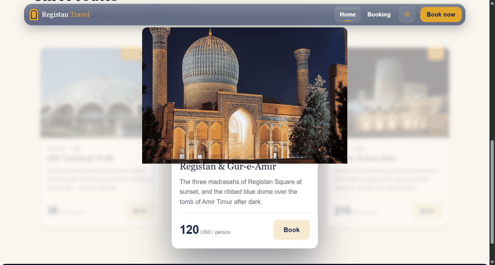
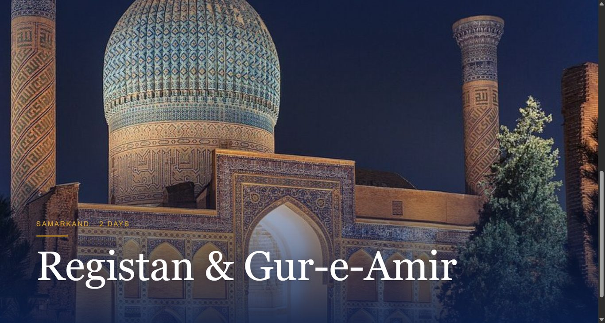
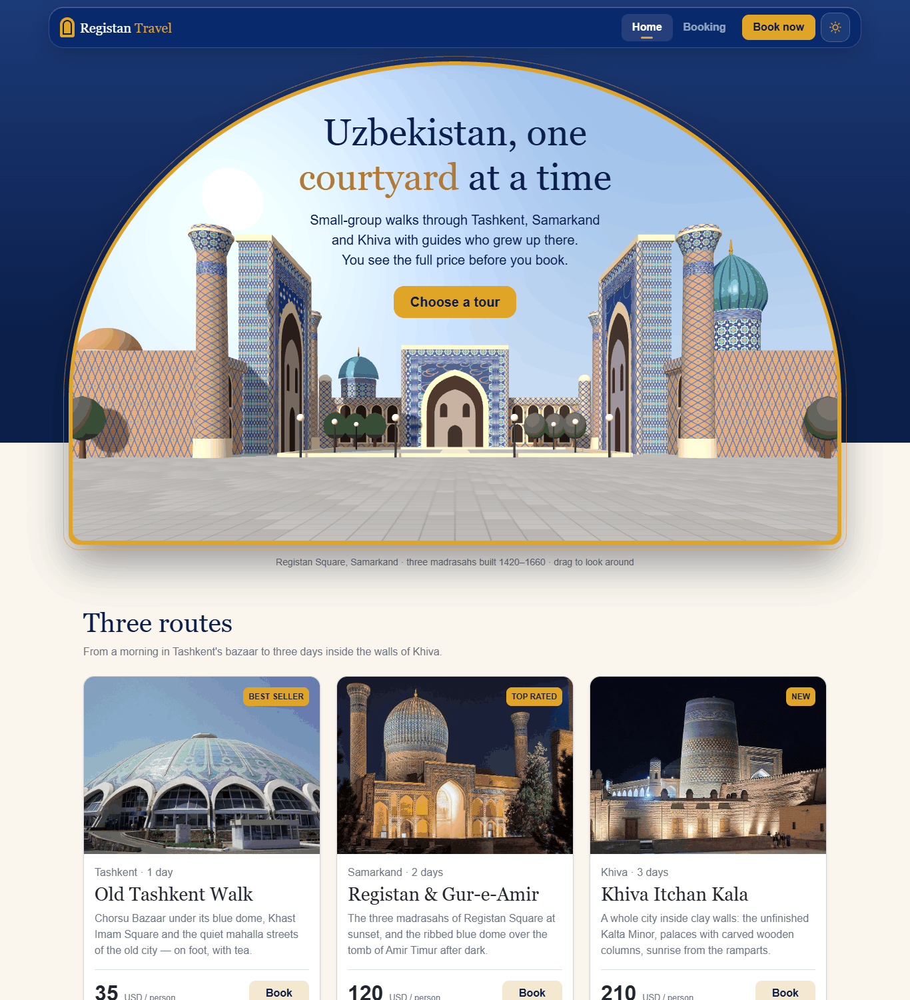

<div align="center">

# Registan Travel

**Узбекистан, один двор за раз — сайт туристического агентства с живой 3D-площадью Регистан в арке.**




</div>

## Что это

Учебный проект по курсу **CSIT248 Web Technologies, Lab Work 5 (Case Study)**. Вымышленное агентство Registan Travel из Ташкента просит сайт из двух страниц: главную с турами и страницу бронирования. Базы данных нет — форма проверяется и подтверждается прямо в браузере. Те же туры также собраны на Bootstrap 5 для сравнения (Part C).

Заказчица пожелала три вещи: смотреться хорошо на телефоне, показывать итоговую цену до отправки формы и объяснить разницу между своим CSS и Bootstrap. Всё это реализовано.

## Возможности

- **3D-Регистан в арке.** Три медресе, минареты, купола, фонари собраны из простых фигур Three.js, узоры изразцов нарисованы кодом на canvas. Внешних 3D-файлов нет.
- **День и ночь.** При смене темы небо делает пол-оборота: солнце садится справа, луна поднимается слева, зажигаются звёзды, фонари, подсветка фасадов и окна по одному.
- **Облёт мышью или пальцем.** Перетаскивание вращает площадь на 360° и поднимает камеру, двойной клик возвращает исходный вид.
- **Интро-фото один раз за сессию.** Сначала настоящее фото, затем оно растворяется в 3D; при возврате со страницы бронирования сцена включается сразу.
- **Шапка «жидкое стекло»:** фиксированная панель с размытием фона (`backdrop-filter`).
- **Светлая и тёмная тема** с сохранением выбора в `localStorage`, без «моргания» при загрузке.
- **Карточки туров** с 3D-наклоном за курсором и бликом; клик запускает «влёт» к форме бронирования, выбранный тур подставляется автоматически.
- **Живая цена и скидка:** «Total: 5 × 120 USD = 600 USD − 10% = 540 USD», для групп от 5 человек скидка 10%.
- **Валидация без перезагрузки:** красное сообщение и подсветка поля либо зелёное подтверждение с именем и суммой.
- **Плавная прокрутка** к списку туров.
- **Mobile first:** 1 колонка на телефоне, 2 с 768px, 3 с 1200px.
- **Поддержка `prefers-reduced-motion`:** анимации отключаются, 3D остаётся статичным.

## Скриншоты

<table>
  <tr>
    <td align="center"><br><sub>Главная, день</sub></td>
    <td align="center"><br><sub>Главная, ночь</sub></td>
  </tr>
  <tr>
    <td align="center"><br><sub>Бронирование, светлая тема</sub></td>
    <td align="center"><br><sub>Бронирование, тёмная тема</sub></td>
  </tr>
  <tr>
    <td align="center"><br><sub>Телефон, главная (390px)</sub></td>
    <td align="center"><br><sub>Телефон, бронирование</sub></td>
  </tr>
  <tr>
    <td align="center"><br><sub>«Влёт» в тур, кадр 1</sub></td>
    <td align="center"><br><sub>«Влёт» в тур, кадр 2</sub></td>
  </tr>
  <tr>
    <td align="center" colspan="2"><br><sub>Версия на Bootstrap 5 (index-bootstrap.html)</sub></td>
  </tr>
</table>

## Как запустить

Самый простой способ: открыть `index.html` двойным кликом. Всё лежит в проекте, включая Three.js, поэтому сайт работает и с диска.

Или через локальный сервер:

```bash
python -m http.server 8080
```

и открыть <http://localhost:8080/>. Для `index-bootstrap.html` нужен интернет: Bootstrap подключается с CDN.

## Структура проекта

```
registan-travel/
├── index.html              главная (Part A)
├── booking.html            бронирование (Part B)
├── index-bootstrap.html    главная на Bootstrap 5 (Part C)
├── css/
│   ├── style.css           один стилевой файл для двух страниц
│   └── bootstrap-theme.css бренд-цвета поверх Bootstrap
├── js/
│   ├── main.js             цена, валидация, подтверждение
│   ├── theme.js            светлая/тёмная тема
│   ├── cards.js            наклон карточек и «влёт»
│   ├── scroll.js           плавная прокрутка к турам
│   ├── registan-3d.js      3D-сцена Регистана
│   └── vendor/             Three.js, GLTFLoader, meshopt_decoder
├── images/                 фото туров (Wikimedia Commons)
├── docs/screenshots/       скриншоты для README
├── DOCS.md                 подробная документация
└── README.md
```

## Технологии

HTML5, CSS3 (переменные, grid, flexbox, `backdrop-filter`, медиа-запросы), JavaScript без фреймворков, Three.js r149 (WebGL), Bootstrap 5.3 для сравнения. Шрифты по заданию: Georgia для заголовков, Arial для текста.

## Соответствие заданию

| Требование | Где реализовано |
|---|---|
| A: фиксированная шапка, логотип слева, меню справа на flexbox | `.site-header`, `.site-header .container` в `css/style.css` |
| A: ссылки меню в порядке LVHA, золотой фон при hover, золотая черта у текущей | `.main-nav a:link/:visited/:hover/:active`, `a.active::after` |
| A: hero с градиентом, кнопка уменьшается при нажатии | `#hero`, `.btn:active { transform: scale(...) }` |
| A: три карточки `div.card`, бейдж в правом верхнем углу, подъём при hover | `.card { position: relative }`, `.badge { position: absolute }` |
| A: mobile first, 1 / 2 / 3 колонки | `.card-grid` + `@media (min-width: 768px)` и `(min-width: 1200px)` |
| A: `border-box`, `<span>`, ID-селектор, групповой селектор | `*, *::before, *::after`, `#hero`, `<span>` в заголовке hero |
| B: поля, labels сверху, ширина 100%, `:focus`, красная звёздочка через `::after` | `booking.html`, раздел 9 `style.css` |
| B: живая цена, скидка 10% от 5 человек | `calculateTotal()`, `updatePrice()` в `main.js` |
| B: валидация без перезагрузки, красное и зелёное сообщения | `handleSubmit()` в `main.js` |
| C: Bootstrap 5, navbar, `container / row / col-*`, cards, те же 1/2/3 и цвета | `index-bootstrap.html`, `bootstrap-theme.css` |
| C: предложение со сравнением объёма CSS | `DOCS.md`, раздел про Part C |
| D: три бага с названием причины и исправлением | `DOCS.md`, раздел Part D |
| Без inline-стилей и `<style>` в HTML, без `!important` | в HTML нет атрибутов `style` и тегов `<style>`, в CSS нет `!important` |

Баллы по рубрике: A 40, B 30, C 10, D 20, всего 100.

## Источники фото и лицензии

Фото с Wikimedia Commons: Registan, Gilad Rom (CC BY 2.0); Chorsu Bazaar, Adam Harangozó (CC BY-SA 4.0); Gur-e-Amir, Arina Pan (CC BY-SA 4.0); Kalta Minor, Bgag (CC0). 3D: [Three.js](https://threejs.org), лицензия MIT.

---

<div align="center">

Автор: Karimov Mansurjon, CSIT248 Lab 5, Amity University Tashkent

</div>
